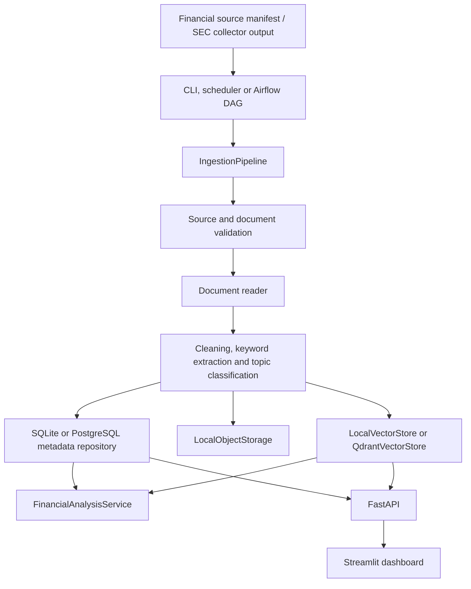
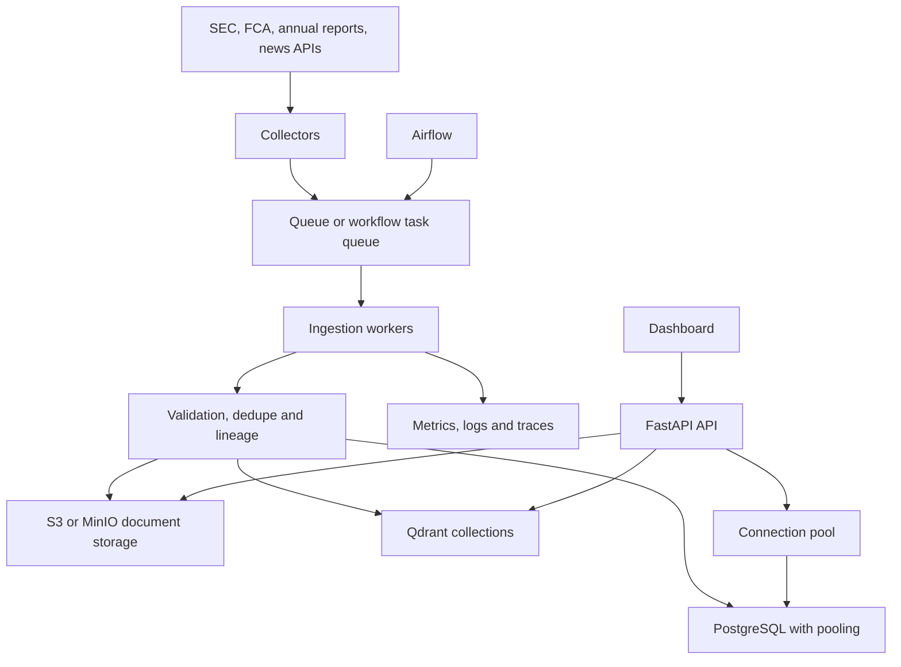

# Architecture

This document separates the current implemented system from the production target architecture. The project is intentionally production-style: it demonstrates realistic engineering boundaries without pretending every cloud-operated component is already implemented.

## A. Current Implemented Architecture

The platform ingests financial document sources, validates them, extracts text, processes metadata, stores results and exposes search and cited analysis through API and dashboard interfaces.

Implemented components:

- `fkip.domain`: source/document models, chunking, processing and validation rules.
- `fkip.application`: ingestion pipeline, orchestration, metrics, reporting, benchmarking, indexing and RAG analysis services.
- `fkip.infrastructure`: document reader, metadata repositories, local object storage, embeddings, local vector store and Qdrant vector store.
- `fkip.interfaces.api`: FastAPI endpoints for health, ingestion, document metadata, search, pipeline metrics and cited analysis.
- `fkip.interfaces.dashboard`: Streamlit UI that calls FastAPI instead of duplicating business logic.
- `dags/financial_knowledge_ingestion_dag.py`: Airflow-compatible DAG that delegates to the application pipeline.
- `alembic/`: PostgreSQL schema migrations for `documents`, `document_sources`, `ingestion_runs` and `ingestion_items`.
- `.github/workflows/ci.yml`: lightweight CI for dependency install, tests, compile checks, Docker build, Compose config and Alembic SQL generation.

Storage behavior:

- SQLite is the default local metadata store.
- PostgreSQL is available through `DATABASE_URL` and Alembic migrations.
- Raw extracted text is currently stored by `LocalObjectStorage` under `OBJECT_STORE_PATH`.
- MinIO is included in Docker Compose as a future object-storage-compatible deployment option, but it is not currently wired as the active storage adapter.
- `LocalVectorStore` is retained for tests and demos.
- Qdrant is available through `VECTOR_STORE_BACKEND=qdrant` for production-style vector retrieval.

## B. Production Target Architecture

The target architecture would keep the same boundaries but replace synchronous and local components with managed, observable and horizontally scalable services.

Reasonable future evolution:

- Queue or worker-based ingestion so API requests create jobs instead of doing long document processing synchronously.
- S3/MinIO adapter for raw documents, checksums and immutable source artifacts.
- PostgreSQL connection pooling, transaction boundaries and read/write query tuning.
- Stronger document-level retry, checkpoint and resume behavior.
- Backfill support for failed or partially processed ingestion runs.
- Payload indexes, snapshots and backup strategy for Qdrant collections.
- OpenTelemetry traces, Prometheus metrics and alerting on failure rates, throughput and latency.
- CI integration services for PostgreSQL and Qdrant when the project needs stronger end-to-end validation.

Non-goals for this portfolio version:

- Spark is unnecessary because the project demonstrates document-scale pipeline design rather than distributed table processing.
- Kafka is unnecessary because the implemented workload is batch and scheduled ingestion, not high-throughput event streaming.
- Kubernetes is unnecessary because Docker Compose is sufficient to show service boundaries for a portfolio project.
- Celery is unnecessary until ingestion is moved from synchronous batch execution to a real job queue.
